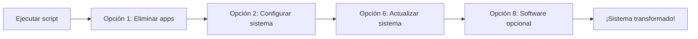

<div align="center">
  
# 🚀 Kubuntu Transformer

### Transforma tu Kubuntu en un sistema minimalista estilo KDE Neon

[](LICENSE)
[](https://www.gnu.org/software/bash/)
[](https://kde.org/plasma-desktop/)
[](https://ubuntu.com/)

</div>

---

## 📖 Descripción

**Kubuntu Transformer** es un script interactivo que te permite convertir tu instalación de Kubuntu en un sistema minimalista similar a **KDE Neon**. Con una interfaz de menús fácil de usar, puedes:

- 🗑️ **Eliminar** aplicaciones preinstaladas de Kubuntu
- ⚙️ **Configurar** el sistema al estilo Neon (backports, sin Snap)
- 🎨 **Instalar** terminal Alacritty y temas modernos (Tokyo Night)
- 📦 **Agregar** software opcional popular (VSCode, Chrome, Discord, etc.)
- ↩️ **Revertir** todos los cambios a la configuración original

> ⚠️ **Nota**: Este script está diseñado para **Kubuntu 22.04 LTS o superior**.

---

## ✨ Características

| Categoría | Funcionalidades |
|-----------|----------------|
| **Limpieza** | Eliminación selectiva de +25 apps preinstaladas (juegos, PIM, utilidades) |
| **Snap** | Eliminación completa del sistema Snap (estilo Neon puro) |
| **Backports** | Activación de repositorios para Plasma actualizado |
| **Terminal** | Instalación y configuración de Alacritty con tema Tokyo Night |
| **Temas** | Instalación de themes visuales modernos para KDE Plasma |
| **Software** | 19 programas opcionales listos para instalar con un clic |
| **Revertir** | Restauración completa al estado original de Kubuntu |

---

## 📋 Requisitos

- **Kubuntu** 22.04 LTS o superior
- Conexión a internet
- Usuario con privilegios `sudo`

---

## 🔧 Instalación

### 1. Descargar el script

```bash
git clone https://github.com/george0884/Extremely-custom-Kubuntu.git
cd Extremely-custom-Kubuntu
```

O directamente:

```bash
wget https://raw.githubusercontent.com/george0884/Extremely-custom-Kubuntu/main/Kubuntu-clean.sh
```

2. Dar permisos de ejecución

```bash
chmod +x Kubuntu-clean.sh
```

3. Ejecutar

```bash
./Kubuntu-clean.sh
```

💡 No es necesario ejecutarlo como root. El script solicitará sudo cuando sea necesario.

---

🎮 Menú Principal

```
 1) 🗑️  Eliminar aplicaciones preinstaladas
 2) ⚙️  Configurar sistema (Rolling Release)
 3) 🎮 Optimizar GPU (NVIDIA/AMD/Intel)
 4) ⚡ Optimizar Kernel (Liquorix/XanMod/Estándar)
 5) 💾 Optimizar Memoria RAM (automático)
 6) 🔄 ACTUALIZAR SISTEMA (update/upgrade/clean)
 7) 🖥️  Instalar Alacritty (terminal GPU) y temas
 8) 📦 Instalar software opcional
 9) ↩️  Revertir a Kubuntu original
10) ☢️  ELIMINACION NUCLEAR DE SNAP
11) 🔄 REINSTALAR SNAP
12) 🔧 REPARAR GRUB (BIOS/EFI/Rescue)
13) 🔌 Apagar / Reiniciar sistema
14) 🧹 Quitar accesos directos (escritorio y panel)
15) ❌ Salir
```

---

⚡ Cambio de kernel

| Opción | Kernel | Notas |
|--------|--------|-------|
| 1 | Liquorix (basado en Zen) | PPA `damentz/liquorix`, solo amd64 |
| 2 | XanMod | Repositorio oficial de XanMod; elige x64v2/x64v3 según tu CPU |
| 3 | Oficial de Ubuntu | Elige **LTS (GA)**, **HWE** o una **versión específica**; elimina Liquorix/XanMod |
| 4 | Oficial + Livepatch | LTS o HWE + Ubuntu Pro (solo versiones LTS, requiere Snap) |

Dentro de la opción 3:

- **LTS / GA** (`linux-generic`): el kernel con el que salió la versión de Ubuntu. Máxima estabilidad.
- **HWE** (`linux-generic-hwe-XX.04`): kernel más reciente para hardware nuevo (solo en versiones LTS).
- **Versión específica**: lista las 15 versiones oficiales más recientes y GRUB arranca siempre la elegida.
- Al final se puede dejar **solo esa versión**, borrando el resto de kernels oficiales.
- El kernel en uso nunca se borra en caliente: se elimina al reiniciar y volver a abrir el script.

- Liquorix y XanMod **no están firmados**: requieren **Secure Boot desactivado** (el script lo comprueba).
- El kernel oficial se conserva siempre como respaldo. Si un kernel no arranca, elige el `generic`
  en *Opciones avanzadas* de GRUB (Shift/Esc al encender) y usa la opción 3.
- Los errores se muestran en pantalla y el detalle completo queda en `~/kubuntu-lite.log`.

---

↩️ Revertir (opción 9)

- Quita el PPA backports y **baja Plasma a la versión oficial** (quitar el PPA no lo hace solo).
- Desbloquea Snap y reinstala `kubuntu-desktop` **con todas sus aplicaciones**.
- Reinstala todo lo que el script eliminó (incluidas dependencias); la lista está en
  `~/.local/share/kubuntu-lite/paquetes-eliminados.txt`.
- Restaura los íconos del escritorio y las aplicaciones fijadas del panel quitadas con la opción 14.

---

📦 Software Opcional Disponible

Programa Descripción Tipo
FileZilla Cliente FTP/SFTP 🖥️ GUI
VS Code Editor de código 🖥️ GUI
VirtualBox Máquinas virtuales 🖥️ GUI
Google Chrome Navegador web 🖥️ GUI
Telegram Mensajería 🖥️ GUI
Discord Chat de voz/texto 🖥️ GUI
Spotify Música streaming 🖥️ GUI
OBS Studio Grabación/streaming 🖥️ GUI
Python 3 Lenguaje de programación ⌨️ CLI
PIP Gestor paquetes Python ⌨️ CLI
Git Control de versiones ⌨️ CLI
Fastfetch Info del sistema ⌨️ CLI
Timeshift Backups del sistema 🖥️ GUI
GParted Editor de particiones 🖥️ GUI
HTOP Monitor de sistema ⌨️ CLI
Vim Editor de texto ⌨️ CLI
Curl / Wget Transferencias ⌨️ CLI

---

🗑️ Aplicaciones que puedes eliminar

El script permite eliminar selectivamente:

Juegos: KMahjongg, KMines, KPat, KSudoku, KBreakout, KNetwalk
Multimedia: Dragon Player, Juk, K3b, KTorrent
PIM/Suite: KMail, Kontact, KOrganizer, KAddressBook, KAlarm
Utilidades: KWrite, Kate, KRuler, KMag, KCharSelect, KDF, KFind, KGpg
Internet: Akregator, Konversation, KRDC
Oficina: LibreOffice (completo)
Snap: Sistema completo de Snap (Firefox, Store, etc.)

---

🔄 Flujo de trabajo recomendado



---

🛡️ Seguridad

· ✅ No destructivo: Todos los cambios son reversibles
· ✅ Confirmaciones: Cada acción crítica requiere confirmación
· ✅ Backports opcional: No se modifica el sistema si no deseas
· ✅ Revertir completo: Opción para volver a Kubuntu 100% original

---

📸 Capturas

Menú de selección de software opcional

```
┌─────────────────────┤ Instalar Software Adicional ├─────────────────────┐
│                                                                         │
│    Usa ESPACIO para seleccionar los programas que QUIERES INSTALAR:     │
│                                                                         │
│    (*) filezilla      Cliente FTP/SFTP                                  │
│    ( ) code           Visual Studio Code (editor)                       │
│    (*) virtualbox     VirtualBox (máquinas virtuales)                   │
│    ( ) google-chrome  Google Chrome (navegador)                         │
│    (*) fastfetch      Fastfetch (info del sistema)                      │
│                                                                         │
│    <OK>                              <Cancelar>                         │
└─────────────────────────────────────────────────────────────────────────┘
```

Terminal Alacritty con tema Tokyo Night

```
┌─────────────────────────────────────────────────────────────────────────┐
│  ┌───────────────────────────────────────────────────────────────────┐  │
│  │  user@kubuntu:~$ fastfetch                                        │  │
│  │                                                                   │  │
│  │       .:///:-.                    user@kubuntu                    │  │
│  │     .:////////:-.                 OS: Kubuntu 24.04               │  │
│  │    -////////////////:.            Kernel: 6.8.0-xx               │  │
│  │   `:////////////////:.            Shell: bash 5.2.15              │  │
│  │    :+///////////////+`            DE: KDE Plasma 6.0.4            │  │
│  │   `-/+++++++++++++/.              Theme: Tokyo Night              │  │
│  │    `.-://///:-.`                  Terminal: Alacritty             │  │
│  │                                                                   │  │
│  └───────────────────────────────────────────────────────────────────┘  │
└─────────────────────────────────────────────────────────────────────────┘
```

---

❓ Preguntas Frecuentes

¿Puedo usar esto en Ubuntu normal con KDE instalado manualmente?

No está recomendado. El script está diseñado específicamente para Kubuntu de fábrica.

¿Qué pasa si elimino Snap?

Firefox y la tienda Snap se eliminarán. En Ubuntu `apt install firefox` solo instala el snap, así que usa el PPA de Mozilla: `sudo add-apt-repository ppa:mozillateam/ppa`

¿Cómo vuelvo atrás?

Usa la Opción 9 del menú principal. Reinstalará kubuntu-desktop y restaurará Snap.

¿Necesito reinstalar después de ejecutar el script?

No es necesario, pero se recomienda reiniciar para aplicar todos los cambios correctamente.

---

🤝 Contribuciones

Las contribuciones son bienvenidas. Puedes:

1. Reportar errores en Issues
2. Sugerir nuevos programas para incluir en la lista opcional
3. Mejorar la documentación

---

📄 Licencia

Este proyecto está bajo la licencia MIT. Ver archivo LICENSE para más detalles.

---

<div align="center">

👤 Autor

Oldtheone – @george0884

</div>

---

<div align="center">

⭐ ¿Te fue útil este script? ¡Dale una estrella en GitHub!

</div>
