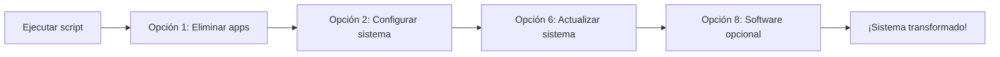

<div align="center">
  
# 🚀 Ubuntu Ultimate Tools

### Limpia, optimiza y repara cualquier sabor de Ubuntu desde un solo menú

[](LICENSE)
[](https://www.gnu.org/software/bash/)
[](https://ubuntu.com/)

</div>

---

## 📖 Descripción

**Ubuntu Ultimate Tools** es un script interactivo para dejar tu Ubuntu más liviano, rápido y a tu gusto,
sin importar el sabor. Al iniciar **detecta qué sabor y qué escritorio tienes** y adapta sus opciones:

- 🗑️ **Eliminar** las apps preinstaladas de tu sabor (con un seguro que nunca quita piezas del escritorio)
- ⚡ **Cambiar de kernel** (Liquorix, XanMod, oficial LTS/HWE) y **reparar o personalizar GRUB**
- 🎮 **Optimizar** GPU, RAM, red, DNS y energía, o aplicar un **perfil automático** (gaming, productividad...)
- 📦 **Instalar** software popular y la terminal Alacritty con tema Tokyo Night
- ↩️ **Deshacer** cualquier cambio o **revertir** a tu sabor original

---

## 🐧 Sabores compatibles

| Sabor | Escritorio | Notas |
|-------|------------|-------|
| **Ubuntu** (completo o mínimo) | GNOME | Modo oscuro, dock e indexador de GNOME |
| **Kubuntu** | KDE Plasma | Tema Tokyo Night, panel de Plasma, Baloo y KDE Rolling Release (backports) |
| **Xubuntu** | Xfce | |
| **Lubuntu** | LXQt | |
| **Ubuntu MATE** | MATE | |
| **Ubuntu Budgie** | Budgie | |
| **Ubuntu Cinnamon** | Cinnamon | |
| **Ubuntu Unity** | Unity | |
| **Ubuntu Studio** | KDE Plasma | Igual que Kubuntu |
| **Edubuntu** | GNOME | Igual que Ubuntu |
| **Ubuntu Kylin** | UKUI | Sin lista propia de apps: solo las comunes |
| **Ubuntu Server** | sin escritorio | Kernel, GRUB, red, RAM, Snap y actualizaciones |

El sabor se detecta por su meta-paquete (`kubuntu-desktop`, `xubuntu-desktop`...). Si lo quitaste con la
opción 2, se reconoce por su escritorio. Las opciones que no aplican a tu escritorio lo explican y no hacen nada.

---

## 📋 Requisitos

- **Ubuntu 22.04 LTS o superior**, cualquier sabor
- Conexión a internet
- Usuario con privilegios `sudo`

---

## 🔧 Instalación

### 1. Descargar el script

El repositorio es **privado**: para descargarlo hay que iniciar sesión en GitHub
(`wget` o un `git clone` sin sesión no funcionan).

**Opción A: con Git** (inicia sesión una sola vez con GitHub CLI)

```bash
sudo apt install gh
gh auth login          # GitHub.com → HTTPS → Yes → Login with a web browser
git clone https://github.com/george0884/ubuntu-ultimate-tools.git
cd ubuntu-ultimate-tools
```

Para actualizar más adelante: `git pull`

**Opción B: desde la web**

En la página del repositorio: **Code → Download ZIP**, y descomprímelo.

2. Dar permisos de ejecución

```bash
chmod +x ubuntu-ultimate-tools.sh
```

3. Ejecutar

```bash
./ubuntu-ultimate-tools.sh
```

💡 No es necesario ejecutarlo como root. El script solicitará sudo cuando sea necesario.

---

🎮 Menú Principal

```
 1) 🗑️  Eliminar aplicaciones preinstaladas
 2) ⚙️  Configurar sistema (meta-paquete, manuales y, en KDE, Rolling Release)
 3) 🎮 Optimizar GPU (NVIDIA/AMD/Intel)
 4) ⚡ Optimizar Kernel (Liquorix/XanMod/Estándar)
 5) 💾 Optimizar Memoria RAM (automático)
 6) 🔄 ACTUALIZAR SISTEMA (update/upgrade/clean)
 7) 🖥️  Instalar Alacritty (terminal GPU) y temas
 8) 📦 Instalar software opcional
 9) ↩️  Revertir a tu sabor original
10) ☢️  ELIMINACION NUCLEAR DE SNAP
11) 🔄 REINSTALAR SNAP
12) 🔧 ARRANQUE: reparar y personalizar GRUB/EFI
13) 🔌 Apagar / Reiniciar sistema
14) 🧹 Quitar accesos directos (escritorio y panel)
15) 🌐 Red, DNS y drivers
16) 🔋 Energía y rendimiento
17) 🚀 PERFILES AUTOMÁTICOS (gaming, productividad...)
18) ↩️  Deshacer optimizaciones / quitar programas

 0) ❌ Salir
```

---

🚀 Perfiles automáticos

Aplican varias optimizaciones de una vez, sin preguntas intermedias. Se eligen desde el menú (opción 17)
o desde la terminal:

```bash
./ubuntu-ultimate-tools.sh --perfiles                  # lista los perfiles
./ubuntu-ultimate-tools.sh --perfil gaming             # muestra el plan y pide una confirmación
./ubuntu-ultimate-tools.sh --perfil productividad --si # sin confirmación
```

| Perfil | Qué hace |
|--------|----------|
| `productividad` | Actualiza, quita juegos, instala git/htop/timeshift..., RAM + ZRAM, TRIM, DNS más rápido, TCP BBR |
| `gaming` | Drivers recomendados, kernel Liquorix, GameMode + MangoHud, energía al máximo, sin Baloo, Wi-Fi sin ahorro, BBR, DNS |
| `ahorro` | TLP en portátiles (perfil de ahorro en PC), sin Baloo, ZRAM, RAM, TRIM |
| `desarrollo` | git, build-essential, Python, VSCode, más vigilancia de archivos para IDEs, RAM, ZRAM, BBR, DNS |
| `minimalista` | Mínimo: sin el meta-paquete del sabor ni apps extra, sin Snap, Firefox .deb de Mozilla (en KDE, Plasma de backports) |

- Si un paso falla, el perfil sigue con los demás y al final muestra un resumen ✓/✗.
- Las preguntas internas (por ejemplo, instalar CUDA) se responden "no" automáticamente.
- El perfil `gaming` omite Liquorix si Secure Boot está activado.
- El perfil `minimalista` copia antes los perfiles de Firefox/Thunderbird del snap para no perder marcadores.

---

🌐 Red, DNS y drivers (opción 15)

- **DNS**: Cloudflare, Cloudflare con bloqueo de malware, Google, Quad9 o AdGuard (bloquea anuncios), con DNS
  cifrado cuando el servidor lo permite. También puede **medir cuál responde más rápido** desde tu conexión.
  Si con el DNS elegido no se resuelven nombres, vuelve solo al automático.
- **TCP BBR**: mejora velocidad y latencia, sobre todo en Wi-Fi y conexiones inestables.
- **Wi-Fi sin ahorro de energía**: evita picos de latencia y microcortes.
- **Drivers**: instala los recomendados por Ubuntu para tu hardware (NVIDIA, Wi-Fi Broadcom, etc.).
- **Firmware**: actualiza BIOS/UEFI, SSD y otros dispositivos con `fwupd`.

> Un DNS rápido acelera el inicio de cada página, pero no aumenta los Mbps contratados.

---

🔋 Energía y rendimiento (opción 16)

Perfiles rendimiento / equilibrado / ahorro, TLP para portátiles, activar o desactivar el indexador
de archivos Baloo, y GameMode + MangoHud para juegos.

MangoHud queda configurado: muestra los FPS en el juego y los graba en ~/mangohud-logs (SysMonitorPro los lee).
Opcionalmente (y siempre en el perfil `gaming`) se activa en todos los juegos Vulkan/Proton sin tocar Steam.
Shift derecho + F12 oculta el panel · Shift izquierdo + F2 pausa/reanuda la grabación.

---

🔧 Arranque: reparar y personalizar GRUB/EFI (opción 12)

Todo lo hace el propio script, sin instalar programas externos.

| | Opción | Qué hace |
|---|---|---|
| 🔍 | **1** Diagnóstico | Estado del arranque: modo UEFI/BIOS, Secure Boot, discos, kernels, configuración de GRUB, menú, entradas UEFI y partición EFI. Lo guarda en `~/diagnostico-arranque.txt` para compartirlo |
| 🔧 | **2** Reparación rápida | Reinstala GRUB y regenera el menú |
| | **3** Reparación completa | Verifica la partición EFI, reinstala los paquetes de GRUB (y shim), reinstala GRUB, regenera el menú, pone Kubuntu primero en UEFI y comprueba el resultado |
| | **4** Instalar GRUB en otro disco | Solo en modo BIOS |
| | **5** Partición EFI | Espacio libre, sistemas registrados y verificación/reparación con `fsck.vfat` |
| 🎨 | **6** Sistema por defecto | Qué entrada arranca sola y cuántos segundos espera el menú |
| | **7** Otros sistemas | Detectar Windows y otras distros (`os-prober`, que Ubuntu trae desactivado) |
| | **8** Orden de arranque UEFI | Poner una entrada primera, o arrancarla solo la próxima vez |
| | **9** Personalizar menú | **Ocultar cualquier entrada** marcándola con la barra espaciadora (cada kernel, Windows, cada memtest, UEFI...), mostrar otros sistemas antes que Kubuntu, recordar el último elegido, colores, imagen de fondo, resolución, parámetros del kernel, **restaurar el menú original** y **deshacer los cambios de Grub Customizer** |
| 🚑 | **10** Reparar desde Live USB | Reparación automática con chroot cuando el sistema no arranca |
| | **11–13** Guías | Prompt `grub>`, `grub rescue>` y reparación manual desde Live USB |

Antes del primer cambio, el script guarda una copia de `/etc/default/grub`
(`/etc/default/grub.ubuntu-ultimate-tools.orig`) para poder volver al menú original.

Para ocultar entradas sueltas, el script desactiva el script de GRUB que las genera y en su lugar
ejecuta `<script>_ubuntu_ultimate_tools`, que lo llama y quita las entradas de la lista
`/etc/ubuntu-ultimate-tools/grub-ocultas`. Si una actualización reactiva el original, el filtro se aparta
(sin entradas duplicadas) hasta que se vuelva a usar la opción. No se pueden ocultar todas las
entradas de tu sistema.

Si usaste **Grub Customizer**, la opción 9 → 7 deja `/etc/grub.d` como lo instala Ubuntu: devuelve
cada script a su nombre, quita sus `*_proxy` (que duplican entradas) y guarda antes una copia
completa en `/etc/grub.d.antes-de-deshacer-grub-customizer-<fecha>`.

La reparación automática desde Live USB:

- Detecta UEFI o BIOS, lista las particiones de Linux y desbloquea discos cifrados (LUKS/LVM).
- Monta la raíz (también btrfs con subvolumen `@`), `/boot` y la partición EFI según el `fstab` del sistema.
- Prepara el chroot (`/dev`, `/dev/pts`, `/proc`, `/sys`, `/run`, `efivars`), ejecuta `grub-install` y `update-grub`.
- Si `grub-install` falla, ofrece reinstalar los paquetes de GRUB y reintentar.
- Al final desmonta todo, también si algo falla a mitad de camino.

#### Prepárate antes de necesitarlo

Como el repositorio es privado, desde el Live USB no se puede descargar el script sin iniciar
sesión. Lo más práctico es **guardarlo ahora en un pendrive**, mientras el sistema funciona:

1. Copia `ubuntu-ultimate-tools.sh` a un pendrive (puede ser el mismo del Live USB si tiene una
   partición de datos, o uno aparte).
2. Ten a mano también un **USB de instalación de tu sabor de Ubuntu** (el Live USB).

#### Cuando el sistema no arranca

1. Arranca desde el USB y elige **"Probar Ubuntu"** (o "Probar Kubuntu", "Probar Xubuntu"...).
   Debe arrancar en el mismo modo que el sistema instalado (UEFI o BIOS/Legacy).
2. Conecta el pendrive con el script. Aparece en el gestor de archivos (Dolphin);
   haz clic en él para montarlo.
3. Abre **Konsole** y ejecuta (cambia `PENDRIVE` por el nombre de tu pendrive;
   la tecla TAB lo autocompleta):

```bash
cd /media/$USER/PENDRIVE
bash ubuntu-ultimate-tools.sh      # opción 12 → 10
```

- Se usa `bash ubuntu-ultimate-tools.sh` y no `./ubuntu-ultimate-tools.sh` porque los pendrives FAT32/exFAT
  no guardan el permiso de ejecución.
- `ls /media/$USER/` muestra el nombre exacto del pendrive.
- Si tienes internet en el Live USB y prefieres no usar pendrive: `sudo apt install gh`,
  `gh auth login` y `git clone` (ver *Instalación*).

---

☑️ Selección con barra espaciadora

En "Eliminar aplicaciones" (opción 1) y "Software opcional" (opción 8) las listas usan casillas:
**Espacio** marca o desmarca, **flechas** para moverse, **Enter** para aceptar. La lista de eliminación
solo muestra las apps instaladas, y la de software marca las que ya tienes. Si `whiptail` no está
disponible, se vuelve a la selección escribiendo números.

---

↩️ Deshacer optimizaciones (opción 18)

- **Quitar programas instalados por el script**, con casillas. El script anota en
  `~/.local/share/ubuntu-ultimate-tools/paquetes-instalados.txt` solo los programas que **no tenías antes**;
  los instalados con versiones anteriores del script aparecen marcados "sin registro".
  Antes de desinstalar avisa si se quitará algo más por dependencias.
- **Restaurar ajustes del sistema** (RAM, inotify, BBR...) a sus valores de fábrica.
- **Desactivar ZRAM** y **quitar TLP** (vuelve el selector de energía del escritorio).
- **Restaurar todos los ajustes** de una vez, sin desinstalar programas. "Revertir a tu sabor
  original" (opción 9) también lo hace.

---

En todos los menús y submenús, **0** vuelve al menú anterior (en el principal, sale del script).

---

⏱️ Velocidad

- Las apps se instalan y eliminan **en una sola operación** de apt, no una por una.
- Los `.deb` externos (VSCode, Chrome, Discord) se descargan en paralelo.
- `apt update` se ejecuta una vez por sesión (o se omite si el sistema lo hizo hace menos de 30 minutos).
- Cambiar de kernel no regenera GRUB: se usa `GRUB_DEFAULT=saved` + `grub-set-default`.
- La opción 2 permite desactivar la indexación de manuales (`man-db`), lo más lento de cada instalación.

---

⚡ Cambio de kernel

| Opción | Kernel | Notas |
|--------|--------|-------|
| 1 | Liquorix (basado en Zen) | PPA `damentz/liquorix`, solo amd64 |
| 2 | XanMod | Repositorio oficial de XanMod; elige x64v2/x64v3 según tu CPU |
| 3 | Oficial de Ubuntu | Elige **LTS (GA)**, **HWE** o una **versión específica**; elimina Liquorix/XanMod |
| 4 | Oficial + Livepatch | LTS o HWE + Ubuntu Pro (solo versiones LTS, requiere Snap) |

Dentro de la opción 3:

- **LTS / GA** (`linux-generic`): el kernel con el que salió la versión de Ubuntu. Máxima estabilidad.
- **HWE** (`linux-generic-hwe-XX.04`): kernel más reciente para hardware nuevo (solo en versiones LTS).
- **Versión específica**: lista las 15 versiones oficiales más recientes y GRUB arranca siempre la elegida.
- Al final se puede dejar **solo esa versión**, borrando el resto de kernels oficiales.
- El kernel en uso nunca se borra en caliente: se elimina al reiniciar y volver a abrir el script.

- Liquorix y XanMod **no están firmados**: requieren **Secure Boot desactivado** (el script lo comprueba).
- El kernel oficial se conserva siempre como respaldo. Si un kernel no arranca, elige el `generic`
  en *Opciones avanzadas* de GRUB (Shift/Esc al encender) y usa la opción 3.
- Los errores se muestran en pantalla y el detalle completo queda en `~/ubuntu-ultimate-tools.log`.

---

↩️ Revertir (opción 9)

- Quita el PPA backports y **baja Plasma a la versión oficial** (quitar el PPA no lo hace solo).
- Desbloquea Snap y reinstala el meta-paquete de tu sabor **con todas sus aplicaciones**.
- Reinstala todo lo que el script eliminó (incluidas dependencias); la lista está en
  `~/.local/share/ubuntu-ultimate-tools/paquetes-eliminados.txt`.
- Restaura los íconos del escritorio y las aplicaciones fijadas del panel quitadas con la opción 14.

---

📦 Software Opcional Disponible

Programa Descripción Tipo
FileZilla Cliente FTP/SFTP 🖥️ GUI
VS Code Editor de código 🖥️ GUI
VirtualBox Máquinas virtuales 🖥️ GUI
Google Chrome Navegador web 🖥️ GUI
Telegram Mensajería 🖥️ GUI
Discord Chat de voz/texto 🖥️ GUI
Spotify Música streaming 🖥️ GUI
OBS Studio Grabación/streaming 🖥️ GUI
Python 3 Lenguaje de programación ⌨️ CLI
PIP Gestor paquetes Python ⌨️ CLI
Git Control de versiones ⌨️ CLI
Fastfetch Info del sistema ⌨️ CLI
Timeshift Backups del sistema 🖥️ GUI
GParted Editor de particiones 🖥️ GUI
HTOP Monitor de sistema ⌨️ CLI
Vim Editor de texto ⌨️ CLI
Curl / Wget Transferencias ⌨️ CLI

---

🗑️ Aplicaciones que puedes eliminar (opción 1)

La lista sale de los **meta-paquetes reales de cada sabor**, con dos filtros:

- **Solo apps**: juegos, oficina, correo, multimedia, cámaras, escáneres, torrents, IRC, utilidades...
  Nunca se ofrecen las piezas del escritorio: gestor de archivos, configuración del sistema, panel, sesión,
  gestor de ventanas, red, sonido, Bluetooth, energía, notificaciones, portales o actualizaciones.
- **Solo las que tienes instaladas**: lista de tu escritorio + apps comunes a todos los Ubuntu.

Y un **seguro de dependencias**: antes de borrar, el script simula qué se llevaría `apt`. Si una app
arrastraría una pieza esencial (escritorio, sesión, gestor de inicio de sesión, red, sonido...), **no se
quita** y se explica por qué. Si arrastra otras cosas, se muestran antes de confirmar.

---

🔄 Flujo de trabajo recomendado



---

🛡️ Seguridad

· ✅ No destructivo: Todos los cambios son reversibles
· ✅ Confirmaciones: Cada acción crítica requiere confirmación
· ✅ Backports opcional: No se modifica el sistema si no deseas
· ✅ Revertir completo: Opción para volver a tu sabor de Ubuntu original
· ✅ Seguro de dependencias: nunca se quita una app que arrastre piezas esenciales del sistema

---

📸 Capturas

Menú de selección de software opcional

```
┌─────────────────────┤ Instalar Software Adicional ├─────────────────────┐
│                                                                         │
│    Usa ESPACIO para seleccionar los programas que QUIERES INSTALAR:     │
│                                                                         │
│    (*) filezilla      Cliente FTP/SFTP                                  │
│    ( ) code           Visual Studio Code (editor)                       │
│    (*) virtualbox     VirtualBox (máquinas virtuales)                   │
│    ( ) google-chrome  Google Chrome (navegador)                         │
│    (*) fastfetch      Fastfetch (info del sistema)                      │
│                                                                         │
│    <OK>                              <Cancelar>                         │
└─────────────────────────────────────────────────────────────────────────┘
```

Terminal Alacritty con tema Tokyo Night

```
┌─────────────────────────────────────────────────────────────────────────┐
│  ┌───────────────────────────────────────────────────────────────────┐  │
│  │  user@ubuntu:~$ fastfetch                                        │  │
│  │                                                                   │  │
│  │       .:///:-.                    user@ubuntu                    │  │
│  │     .:////////:-.                 OS: Ubuntu 24.04                │  │
│  │    -////////////////:.            Kernel: 6.8.0-xx               │  │
│  │   `:////////////////:.            Shell: bash 5.2.15              │  │
│  │    :+///////////////+`            DE: KDE Plasma 6.0.4            │  │
│  │   `-/+++++++++++++/.              Theme: Tokyo Night              │  │
│  │    `.-://///:-.`                  Terminal: Alacritty             │  │
│  │                                                                   │  │
│  └───────────────────────────────────────────────────────────────────┘  │
└─────────────────────────────────────────────────────────────────────────┘
```

---

❓ Preguntas Frecuentes

¿Funciona en mi sabor de Ubuntu?

Sí: Ubuntu, Kubuntu, Xubuntu, Lubuntu, MATE, Budgie, Cinnamon, Unity, Studio, Edubuntu, Kylin y Server.
El banner muestra qué sabor y escritorio detectó. En distribuciones basadas en Ubuntu (Mint, Pop!_OS...)
no está probado.

¿Qué pasa si elimino Snap?

Firefox y la tienda Snap se eliminarán. En Ubuntu `apt install firefox` solo instala el snap, así que usa el PPA de Mozilla: `sudo add-apt-repository ppa:mozillateam/ppa`

¿Cómo vuelvo atrás?

Usa la Opción 9 del menú principal. Reinstalará el meta-paquete de tu sabor con todas sus apps y restaurará Snap.

¿Usaba la versión anterior, "Kubuntu Lite"?

No hace falta hacer nada: la primera vez que ejecutes `ubuntu-ultimate-tools.sh`, pasa sola tu configuración
(entradas ocultas de GRUB, programas instalados, ajustes de RAM, DNS, etc.) a los nombres nuevos.

¿Necesito reinstalar después de ejecutar el script?

No es necesario, pero se recomienda reiniciar para aplicar todos los cambios correctamente.

---

🤝 Contribuciones

Las contribuciones son bienvenidas. Puedes:

1. Reportar errores en Issues
2. Sugerir nuevos programas para incluir en la lista opcional
3. Mejorar la documentación

---

📄 Licencia

Este proyecto está bajo la licencia **GNU GPL v3** (o posterior). Ver el archivo [LICENSE](LICENSE).

En resumen: puedes usar, copiar, modificar y compartir el script libremente. Si distribuyes una
versión modificada, debe publicarse con su código fuente y bajo la misma licencia GPL v3.

---

<div align="center">

👤 Autor

Oldtheone – @george0884

</div>

---

<div align="center">

⭐ ¿Te fue útil este script? ¡Dale una estrella en GitHub!

</div>
