# 📸 Capturas de Ubuntu Ultimate Tools

Todos los menús del script, en un Kubuntu 26.04 de ejemplo. En cada equipo el banner muestra el
sabor y el escritorio detectados, y las listas muestran solo lo que está instalado.

[← Volver al README principal](../README.md)

---

## Menú principal

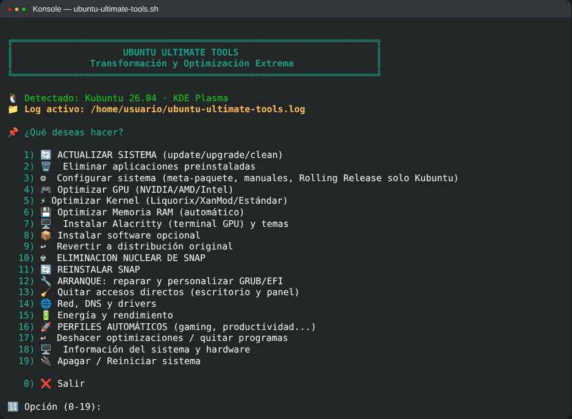

---

## Eliminar aplicaciones (opción 2) — lista con casillas

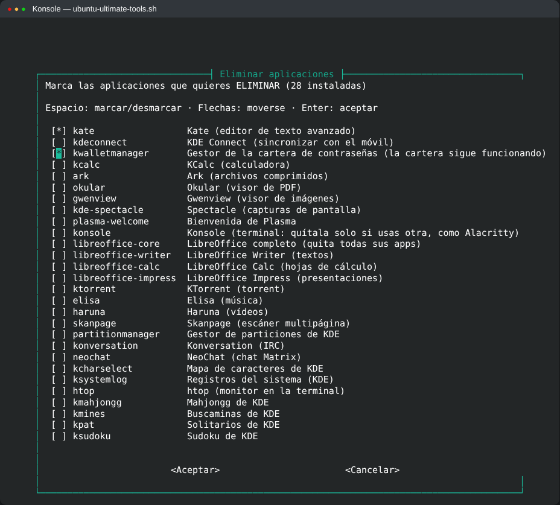

---

## Optimizar GPU (opción 4)

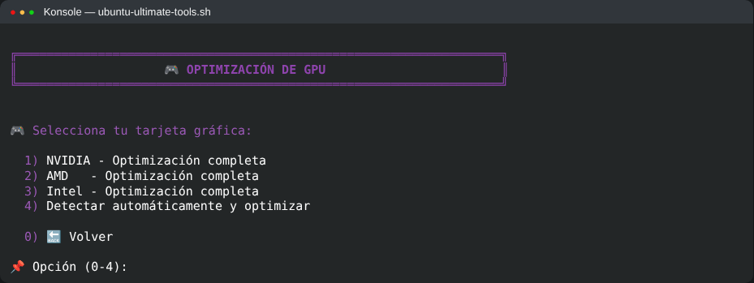

---

## Optimizar kernel (opción 5)

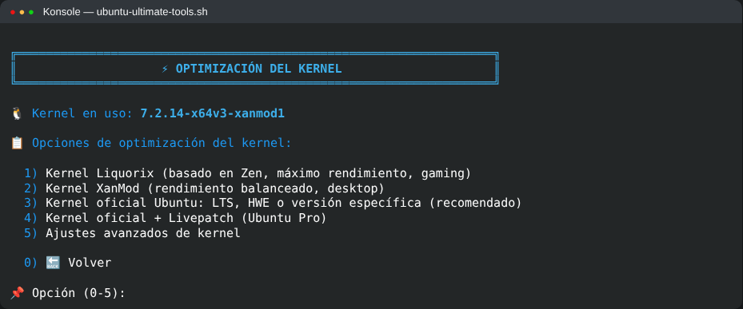

---

## Arranque: reparar y personalizar GRUB/EFI (opción 12)

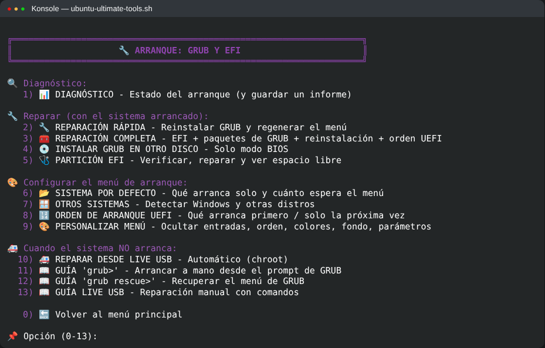

---

## Tarjeta de rescate de tu PC (opción 12 → 14)

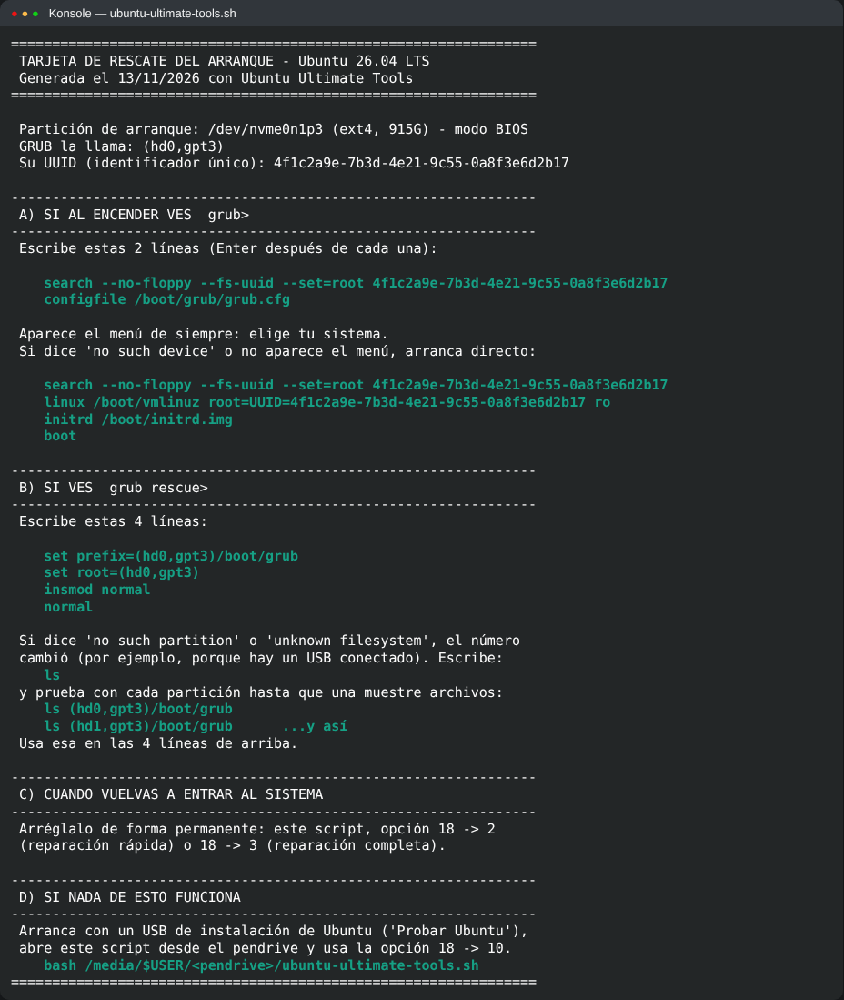

---

## Personalizar el menú de GRUB (opción 12 → 9)

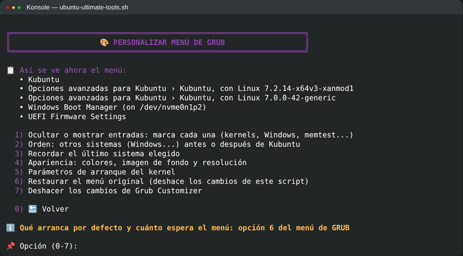

---

## Ocultar entradas del menú de GRUB (opción 12 → 9 → 1)

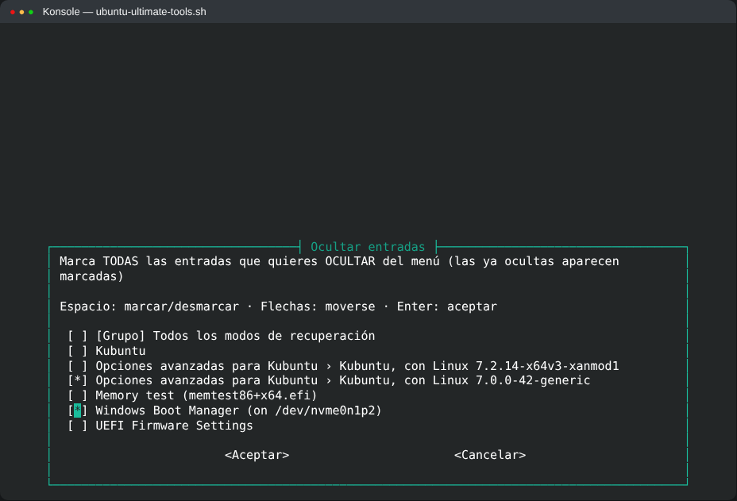

---

## Instalar software opcional (opción 8) — lista con casillas

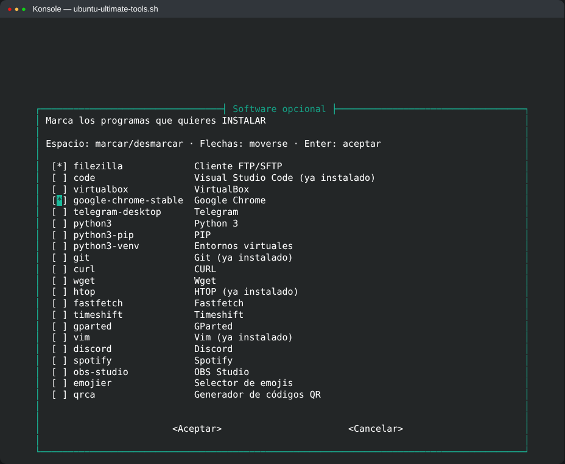

---

## Revertir a distribución original (opción 9)

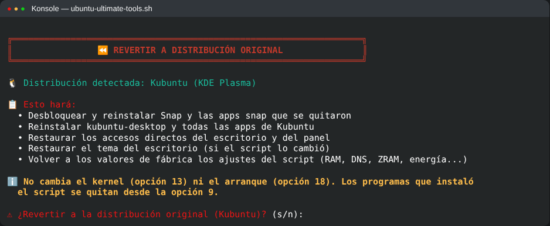

---

## Quitar accesos directos (opción 13)

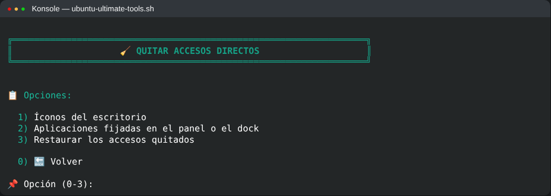

---

## Red, DNS y drivers (opción 14)

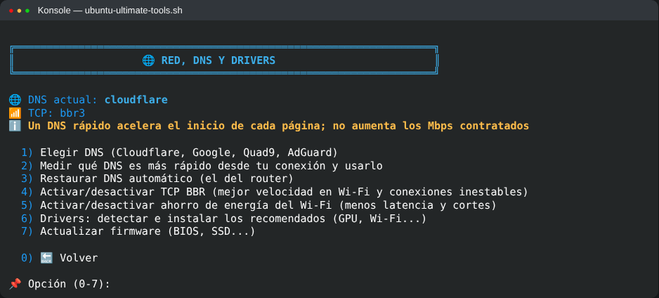

---

## Energía y rendimiento (opción 15)

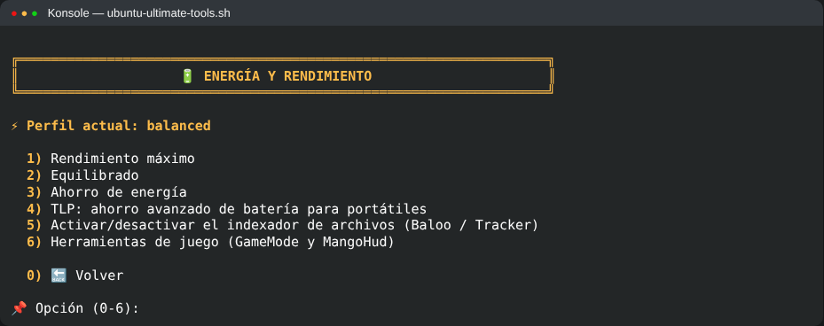

---

## Perfiles automáticos (opción 16)

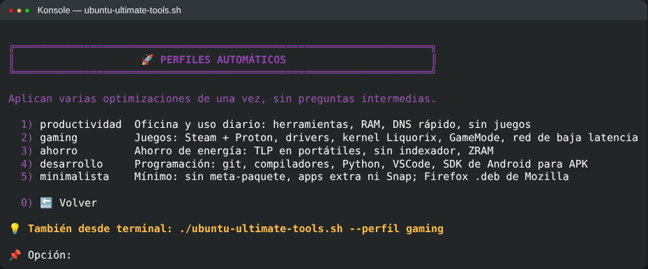

---

## Deshacer optimizaciones (opción 17)

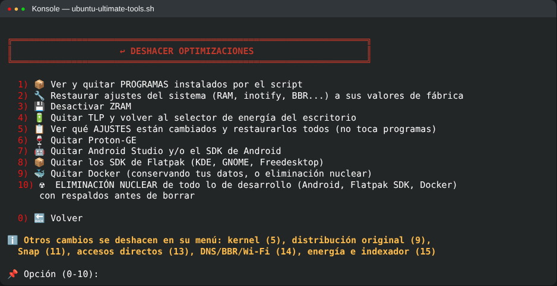

---

## Información del sistema y hardware (opción 18)

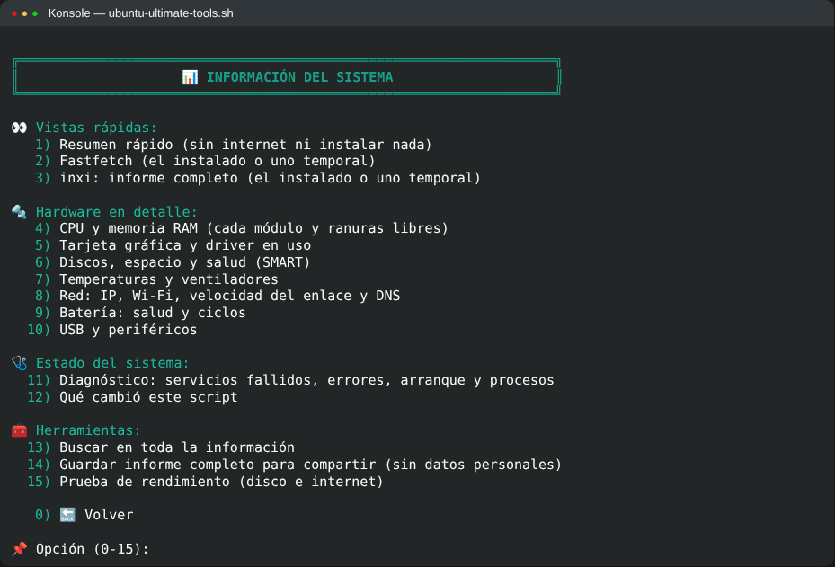

---

## Resumen rápido del sistema (opción 18 → 1)

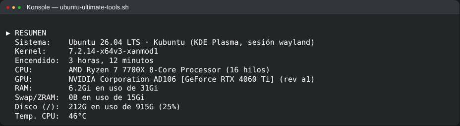
